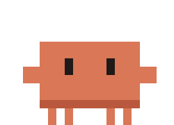

<p align="center"></p>

# code-pet

A simple desktop pet built using Electron. It notifies when the session stops, needs approval, background tasks, active sessions, etc. Built for Claude Code.


## Setup

```bash
npm install
npm run install-hooks
npm start
```

## Run from shortcut

```bash
npm run shortcut
```

to remove: `npm run shortcut -- --remove`.

## Uninstall

```bash
npm run uninstall-hooks
```

removes only the pet's hooks.

## About

Made by Adrian Lara ([contact@adrianlara.dev](mailto:contact@adrianlara.dev)). Released under the [MIT License](LICENSE).
